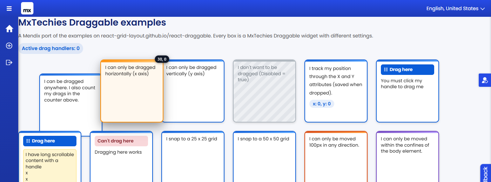

# MxTechies Draggable

> Make any Mendix content draggable, resizable, rotatable and sortable: multi-select and lasso, sortable lists and grids,
> smart guides, z-order, drop previews with accept rules, touch long-press, layout snapshots, collision avoidance,
> auto-scroll, momentum, keyboard dragging, undo, bounds, grid snapping and saved positions and sizes.

A Mendix pluggable widget that makes any content draggable with the mouse or touch. Dragging is built on
[react-draggable](https://react-grid-layout.github.io/react-draggable/) (MIT); everything else is the widget's own code.



-   Mendix 11.0 or newer, web only
-   Category: Containers
-   License: Apache-2.0

An example module that ports every box from the react-draggable demo page is published separately:
[DraggableDemo](https://github.com/bharathidas/MxTechiesDraggableDemo).

## New in 2.0

Everything below is new since 1.0.0. All new options are off by default, so pages built with 1.0 keep working (see
Upgrading in the CHANGELOG for the one deliberate change: a move that cannot be saved is now undone and reported
instead of silently lost).

### Lists, selection and layouts

-   **Multi-select and lasso**: Shift/Ctrl+click, Ctrl+Space, Ctrl+A and a rubber band on the background select items
    of the same **Group**; dragging or arrow-moving any selected item moves them all, clamped so no member leaves its
    bounds, and one Ctrl+Z undoes the whole group move. The count is announced ("3 selected."). Optional **Selected
    attribute** (Boolean) and **On selection change**.
-   **Sortable list and grid mode** (**Sortable**: vertical list, horizontal list, wrapping grid): the other items glide
    out of the way (FLIP), a dashed placeholder shows the landing slot, items can move between lists (also empty ones),
    and the keyboard works too (Space to lift, arrows / Home / End, PageUp / PageDown for the other lists, Space to drop,
    Escape to cancel) with announcements. The widget writes the **Order attribute** of every moved item and runs **On
    reorder** (`oldIndex`, `newIndex`, `containerId`, `fromContainerId`); the new order stays on screen until the list
    shows it, and is rolled back with a Retry message when it does not within **Confirm within**.
-   **Smart guides**: **Equal spacing hints** add design-tool equal gaps (and centring between two neighbours) with gap
    labels, on top of the edge/centre guides and the grid.
-   **Rotation and z-order**: a rotate handle (Shift for 15 degree steps), `[` / `]` keys, **Rotation attribute** and
    **On rotate**; bring forward / back, to front / back with Ctrl+] / Ctrl+[ (Shift for front / back) or the item
    menu, normalised layers in the **Z-index attribute** and **On z-order change**.
-   **Drop previews**: a ghost outline at the real landing spot (grid, snapping, Nudge / Revert, Return if not dropped)
    and `mxt-drop-zone--invalid` on a zone that does not accept the item while it is over it.
-   **Touch long-press** (**Touch long-press (ms)**): on phones a drag only starts after the finger rests, so swiping over
    items still scrolls the page; a short vibration where supported.
-   **Layout snapshots**: named snapshots of positions, sizes, rotation and z-index for a group, in a **Snapshot
    attribute** (JSON) or the browser; saved and restored from the item menu or a **Layout command attribute** ("save
    Morning", "restore Morning", "delete Morning", "reset"); restoring is one undo step; **Reset to snapshot** makes Home
    and double-click go to a snapshot.
-   **Item menu** (right-click, Shift+F10 or the Menu key) with every action the item supports, so each drag operation
    also has a single-click alternative (WCAG 2.2 "Dragging movements").
-   **Reliability**: an error boundary with Try again, a busy state while an action runs, rollback + Retry messages
    instead of silent data loss, a memory-stable registry (checked with 200 mount/unmount cycles), budgets for the
    per-move work (see the CHANGELOG), an SBOM (`npm run sbom`).

### Resizing, rotation and motion

-   **Resizing**: handles on the right edge, bottom edge and bottom-right corner, and Alt + arrow keys (Shift for ten
    steps). Minimum and maximum size, grid steps, optional aspect ratio, capped by the bounds element. The size goes to
    optional **Width attribute** / **Height attribute** (Integer, Long or Decimal), to the browser store with **Remember
    in browser**, and to **On resize** (variables `width`, `height`).
-   **Drop zone accept rules**: a **Drag type** expression on the item and, on zones, classes such as
    `accept-task accept-bug` (or a `data-accept="task bug"` attribute; `*` accepts everything). Zones that do not accept
    the item are marked `mxt-drop-zone--rejected` while dragging and ignore the drop.
-   **Overlap avoidance** (Revert or Nudge): a drop that would cover another draggable returns to its start or moves to
    the nearest free spot (on the grid when there is one), inside the bounds and along the free axes.
-   **Auto-scroll** while dragging near the edge of the page or of the nearest scrollable container.
-   **Undo** (Ctrl+Z, 20 steps) and **reset** (Home or double-click returns to Default X / Y).
-   **On position change** with the variables `x` and `y` after every committed move, for lists and other places where X
    and Y attributes are not available.
-   **Motion**: Full (the 1.0 look plus tilt and ripples), Subtle (glides and springs only, no tilt, ripple or zone squeeze) or Off.
-   **Translatable announcements**: every screen reader message is now a text template (Texts tab).

## Installation

Download `com.mxtechies.widget.web.MxTechiesDraggable.mpk` from the
[latest release](https://github.com/bharathidas/MxTechiesDraggable/releases) (or the Mendix Marketplace) and drop it
into the `widgets` folder of your app, then press F4 in Studio Pro.

## Usage

1. Drop **MxTechies Draggable** on a page and place widgets inside it.
2. Optionally bind **X attribute** and **Y attribute** (Integer, Long or Decimal) to remember the position. They are
   written when a drag ends and the content follows them when they change.
3. Add an **On drag stop** action if you want to commit the position or react to the move.
4. For drag and drop between areas, give the target containers a class such as `drop-zone zone-backlog`, set **Drop zone
   selector** to `.drop-zone` and add an **On drop** action (see [Drop zones](#drop-zones)).

## Properties

| Group                     | Property                         | Purpose                                                                                            |
| ------------------------- | -------------------------------- | -------------------------------------------------------------------------------------------------- |
| Dragging                  | Axis                             | Both, horizontal only, vertical only, or none                                                      |
| Dragging                  | Handle selector                  | CSS selector of the element that starts the drag, e.g. `.drag-handle`                              |
| Dragging                  | Cancel selector                  | Elements that must not start a drag, e.g. `input, button`                                          |
| Dragging                  | Disabled                         | Boolean expression                                                                                 |
| Bounds                    | Bounds                           | None, parent element, page body, a custom selector, or a distance from the start position          |
| Bounds                    | Max left / up / right / down     | Pixel limits used with "Distance from start", e.g. 100 each = "100px in any direction"             |
| Grid snapping             | Grid width / height              | Snap step in pixels, 0 disables                                                                    |
| Position                  | X / Y attribute                  | Persist and control the offset in pixels                                                           |
| Position                  | Default X / Y                    | Offset used when no attribute is bound or it is empty                                              |
| Position                  | Remember in browser (key)        | String expression; saves the position in local storage under this key when no attributes are bound |
| Appearance                | Width                            | Fit content (can move sideways in its parent) or full width                                        |
| Appearance                | Show position badge              | Shows a live "x, y" pill while dragging                                                            |
| Appearance                | Lift while dragging              | Adds a hover shadow and a stronger shadow during the drag                                          |
| Appearance                | Raise list rows                  | Inside a list view, lifts the dragged (or moved) item's row above the other rows; on by default        |
| Appearance                | Animate                          | Tilt, spring glides and returns, drop ripple (default on, off under reduced motion)                |
| Appearance                | Momentum                         | Throw the content; it decays, stays in bounds and lands on the grid (needs Animate)                |
| Interaction / Drop zones  | Drop zone selector               | CSS selector of drop targets, e.g. `.drop-zone`; empty turns drop zones off                        |
| Interaction / Drop zones  | Zone id class prefix             | Default `zone-`: class `zone-backlog` gives target id `backlog`                                    |
| Interaction / Drop zones  | Return if not dropped            | Spring back to the start when released outside every zone                                          |
| Interaction / Snap guides | Snap to siblings / Snap distance | Guides and snapping to other draggables' edges and centres (default 8 px)                          |
| Interaction / Keyboard    | Keyboard dragging                | Focusable, arrow keys move, Enter/Space pick up and drop, Escape cancels (default on)              |
| Interaction / Keyboard    | Keyboard step                    | Pixels per arrow press when there is no grid (default 10)                                          |
| Interaction / Keyboard    | Screen reader instructions       | Text template read on focus                                                                        |
| Events                    | On drag start / On drag stop     | Actions                                                                                            |
| Events                    | On drop                          | Action with variables `targetId` (String), `x`, `y` (Integer, position inside the zone)            |

### Resizing, rotation, drop and motion properties

| Group                                 | Key                                                                                                                                                                                                                 | Type                                            | Default          |
| ------------------------------------- | ------------------------------------------------------------------------------------------------------------------------------------------------------------------------------------------------------------------- | ----------------------------------------------- | ---------------- |
| General / Resizing                    | `resizable`                                                                                                                                                                                                         | boolean                                         | `false`          |
| General / Resizing                    | `widthAttribute`, `heightAttribute`                                                                                                                                                                                 | attribute (Integer, Long, Decimal)              |                  |
| General / Resizing                    | `minWidth`, `minHeight`                                                                                                                                                                                             | integer (px)                                    | `40`             |
| General / Resizing                    | `maxWidth`, `maxHeight`                                                                                                                                                                                             | integer (px), 0 = none                          | `0`              |
| General / Resizing                    | `keepAspectRatio`                                                                                                                                                                                                   | boolean                                         | `false`          |
| Appearance                            | `motion`                                                                                                                                                                                                            | enumeration `full`, `subtle`, `off`             | `full`           |
| Interaction / Drop zones              | `dragType`                                                                                                                                                                                                          | expression (String)                             |                  |
| Interaction / Collision and scrolling | `collision`                                                                                                                                                                                                         | enumeration `none`, `revert`, `nudge`           | `none`           |
| Interaction / Collision and scrolling | `autoScroll`                                                                                                                                                                                                        | boolean                                         | `false`          |
| Interaction / Keyboard                | `undoEnabled`, `resetEnabled`                                                                                                                                                                                       | boolean                                         | `false`          |
| Events                                | `onPositionChange`                                                                                                                                                                                                  | action with Integer variables `x`, `y`          |                  |
| Events                                | `onResize`                                                                                                                                                                                                          | action with Integer variables `width`, `height` |                  |
| Texts / Announcements                 | `pickUpText`, `pickUpZonesText`, `movedText`, `overZoneText`, `droppedOnText`, `droppedAtText`, `cancelledText`, `edgeText`, `resizedText`, `undoneText`, `resetText`, `nudgedText`, `revertedText`, `rejectedText` | text template                                   | English defaults |

Placeholders: `[x]`, `[y]`, `[zone]`, `[width]`, `[height]`.

### Selection, sorting and layout properties

| Group | Key | Type | Default |
| --- | --- | --- | --- |
| General / Dragging | `touchDelay` | integer (ms), 0 = immediate | `0` |
| General / Dragging | `hapticFeedback` | boolean | `true` |
| General / Rotation and stacking | `rotatable` | boolean | `false` |
| General / Rotation and stacking | `rotationAttribute` | attribute (Integer, Long, Decimal) | |
| General / Rotation and stacking | `rotationStep` | integer (degrees) | `15` |
| General / Rotation and stacking | `zOrder` | boolean | `false` |
| General / Rotation and stacking | `zIndexAttribute` | attribute (Integer, Long) | |
| Interaction / Drop zones | `dropPreview` | boolean | `false` |
| Interaction / Snap guides | `equalSpacing` | boolean | `false` |
| Interaction / Keyboard | `contextMenu` (Item menu) | boolean | `false` |
| Interaction / Selection | `multiSelect`, `lasso` | boolean | `false` |
| Interaction / Selection | `lassoSelector` | string (CSS selector) | |
| Interaction / Selection | `groupName` | string | (`default`) |
| Interaction / Selection | `selectedAttribute` | attribute (Boolean) | |
| Interaction / Sorting | `sortMode` | enumeration `off`, `list`, `horizontal`, `grid` | `off` |
| Interaction / Sorting | `sortContainerSelector` | string (CSS selector) | |
| Interaction / Sorting | `sortCrossContainer` | boolean | `false` |
| Interaction / Sorting | `orderAttribute` | attribute (Integer, Long, Decimal) | |
| Interaction / Sorting | `orderOffset` | integer | `0` |
| Interaction / Sorting | `sortTimeout` | integer (ms), 0 = no rollback | `6000` |
| Layout / Snapshots | `snapshotsEnabled` | boolean | `false` |
| Layout / Snapshots | `itemKey` | expression (String) | |
| Layout / Snapshots | `snapshotAttribute`, `layoutCommand` | attribute (String) | |
| Layout / Snapshots | `resetSnapshot` | string | |
| Events | `onSelectionChange` | action, Integer `count` | |
| Events | `onReorder` | action, Integer `oldIndex`, `newIndex`, String `containerId`, `fromContainerId` | |
| Events | `onRotate` | action, Decimal `angle` | |
| Events | `onZOrderChange` | action, Integer `z` | |
| Events | `onSnapshot` | action, String `operation`, `name`, `json` | |
| Texts / Selection, sorting and layout | 40 text templates (announcements, menu entries, messages) | text template | English defaults |

New placeholders: `[count]`, `[index]`, `[list]`, `[angle]`, `[layer]`, `[name]`.

## Free dragging inside a list view

Each item of a list view, template grid or gallery can be dragged on its own and keeps its own position:

1. Add two Integer attributes, for example `PosX` and `PosY`, to the entity the list shows.
2. Put the draggable in the list item (directly, or inside a data view in the item) and bind **X attribute** and
   **Y attribute** to them. Every item reads and writes its own object.
3. Add **On drag stop**: a microflow or nanoflow that commits `$currentObject`, so the position survives a refresh.
4. Leave **Bounds** on None, or use **Custom selector** with the list's class (for example `.task-board`). *Parent
   element* is the item's own small box, so the content could hardly move.
5. Keep **Raise list rows** on (the default): while an item is dragged, and while it rests away from its place, its row
   is lifted above the other rows so it is never hidden behind them or clipped by the row.
   The list container itself is left alone: if your list view has a fixed height with scrolling (or a class that sets
   `overflow: hidden`), notes moved outside it are cut off there, so use **Bounds** Custom selector with the list's class.

To change the order of the items instead of their position, use **Sortable** (next section).

## Sortable lists

1. Put a list view (or gallery) on the page and the draggable inside its item. Set **Sortable** to Vertical list,
   Horizontal list or Wrapping grid.
2. Give the list a class (for example `task-list`) and set **List selector** to `.task-list`; for moves between lists
   give every list the same class, a list id class such as `zone-todo` (or a `data-sort-id`), and turn on **Move between
   lists**.
3. Bind **Order attribute** (Integer) and sort the list view on it, and/or add **On reorder**: a microflow that
   renumbers the items (and changes the list association for a cross-list move), commits and refreshes the list.
4. The new order stays on screen until the list re-renders. If it has not within **Confirm within** (default 6 s, and
   the action has finished), the items move back, the order attributes are restored and the moved item shows "The new
   order was not saved" with Retry.

The widget never moves Mendix DOM nodes itself; it draws the items at their new slots with translates (FLIP) until the
data source shows the new order.

## Layout snapshots

Give every item of a dashboard the same **Group**, turn on **Layout snapshots** and set **Item key** (for example
`toString($currentObject/Id)` or a fixed text per tile). On one item bind **Snapshot attribute** to an unlimited String
attribute of a layout object (or leave it empty to keep snapshots in the browser). Save and restore from the item menu,
or let a button set the **Layout command attribute** to `save Monday`, `restore Monday`, `delete Monday` or `reset`.
The JSON format is documented in `src/utils/snapshots.ts` (`version` 1).

## Drop zones

Any element on the page can be a drop zone: it only has to match **Drop zone selector**. The widget works out the zone's
**target id** in this order:

1. a `data-drop-id` attribute (HTML snippets, custom widgets),
2. a class starting with **Zone id class prefix** (default `zone-`): `class="drop-zone zone-backlog"` gives `backlog`,
3. the `id` attribute,
4. Mendix's generated `mx-name-...` class: a container named `containerDone` gives `containerDone`.

Mendix containers can only set a class and a style, so option 2 is the usual one: set the container's class to
`drop-zone zone-backlog`, `drop-zone zone-doing`, and so on.

When the content is released over a zone (by mouse, touch or keyboard), the X and Y attributes are written, **On drag
stop** runs and then **On drop** runs with:

-   `targetId`: the zone's target id,
-   `x`, `y`: the content's top-left corner relative to the zone's top-left corner, in pixels.

The pointer decides the zone for mouse and touch drags (the smallest zone wins when zones are nested); the widget's
centre decides it for keyboard drops. A click without movement is never a drop. Turn on **Return if not dropped** to
make the content spring back when it lands outside every zone.

Zone classes the widget adds (styled by the widget, override them in your theme):

-   `mxt-drop-zone--armed` on every zone while a drag is in progress (dashed outline),
-   `mxt-drop-zone--over` on the zone that would receive the drop,
-   `mxt-drop-zone--dropped` for a short flash after a drop.

CSS variables: `--mxt-drop-zone-armed`, `--mxt-drop-zone-over`, `--mxt-drop-zone-over-bg`, `--mxt-snap-guide`,
`--mxt-draggable-focus`.

## Keyboard and screen readers

With **Keyboard dragging** on (default) the widget is a tab stop with `role="group"` and
`aria-roledescription="draggable"`, and is described by the **Screen reader instructions** text.

| Key           | Action                                                                                                                      |
| ------------- | --------------------------------------------------------------------------------------------------------------------------- |
| Arrow keys    | Move one grid step, or **Keyboard step** pixels without a grid. Writes the attributes; On drag stop runs once after a pause |
| Shift + arrow | Move ten steps                                                                                                              |
| Enter / Space | Pick up (`aria-grabbed="true"`, On drag start), then drop on the zone under the widget (On drag stop, On drop)              |
| Escape        | Cancel a pick-up and return to where it started                                                                             |

Keys only act when the widget itself has focus, so inputs and buttons inside it keep working. Pick-up, moves, zones and
drops are announced in a polite live region.

Selection and sorting keys (when the feature is on):

| Key | Action |
| --- | --- |
| Ctrl+Space / Ctrl+A / Escape | Toggle this item / select the whole group / clear the selection (multi-select) |
| Arrow keys with a selection | Move every selected item (one undo step) |
| Space, arrows, Home, End, PageUp, PageDown, Space / Escape | Lift, move, first / last position, previous / next list, drop / cancel (sortable) |
| `[` / `]` (Shift: 1 degree) | Rotate by the rotation step |
| Ctrl+] / Ctrl+[ (with Shift) | Bring forward / send backward (to front / to back) |
| Shift+F10 or the Menu key | Open the item menu (arrow keys, Home / End, type-ahead, Enter, Escape) |

Accessibility notes: WCAG 2.2 AA was checked in the browser harness - focus order, 24 px targets for the rotate handle
and menu entries, 4.5:1 text contrast in the menu and messages (light and dark), the menu staying inside the viewport at
200% zoom, right-to-left pages (ArrowLeft moves forward in a horizontal sortable list) and a single-click alternative
for every drag (item menu).

## Motion

**Animate** adds a tilt of up to 3 degrees in the drag direction, a short spring glide between grid steps and keyboard
steps, a spring when returning, a squeeze over a drop zone and a ripple on drop. **Momentum** adds throwing: the release
speed decays exponentially (time constant 325 ms, at most 600 px), is clamped to the bounds and rounded to the grid.
Snapping, tilt and the squeeze use the CSS `translate`, `rotate` and `scale` properties, which compose with
react-draggable's `transform`, so dragging itself is never slowed down. When the operating system asks for reduced
motion, all animation is off and moves are instant.

## CSS hooks

The widget root carries these classes so a theme can react to state:

-   `mxt-draggable--active` while a drag is in progress (react-draggable also adds `react-draggable-dragging`)
-   `mxt-draggable--disabled` when the Disabled expression is true
-   `mxt-draggable--grab` when no handle selector is set, i.e. the whole element is the handle
-   `mxt-draggable--grabbed` while picked up with the keyboard
-   `mxt-draggable--over-zone` while over a drop zone
-   `mxt-draggable--settling` during a return, throw or keyboard glide
-   `mxt-draggable--glide` while dragging on a grid with Animate on
-   `mxt-draggable--animated` and `mxt-draggable--keyboard` when those options are on

The transform is owned by react-draggable, so animate `box-shadow`, `filter`, `scale` or `rotate` in your theme, never
`transform`.

Resizing and motion classes: `mxt-draggable--resizable`, `--sized` (has an explicit size), `--resizing`, `--motion-full` /
`--motion-subtle` / `--motion-off`, the handles `mxt-draggable__resize--e`, `--s`, `--se`, and `mxt-drop-zone--rejected`
on zones. Theme variables: `--mxt-draggable-grip`, `--mxt-drop-zone-rejected`.

Selection and sorting classes: `mxt-draggable--selectable`, `--selected`, `--following` (moving with a selection), `--sortable`,
`--displaced`, `--rotatable`, `--rotating`, `--long-press`, `--armed`, `--saving`; elements `mxt-draggable__body`
(rotated inner body of rotatable items), `__rotate`, `__notice`, `__saving`; on `<body>`: `mxt-lasso`,
`mxt-drop-ghost--valid` / `--invalid` / `--placeholder`, `mxt-spacing-hint`, `mxt-menu`; zones get
`mxt-drop-zone--invalid`; the lasso container gets `mxt-lasso-area`. Theme variables: `--mxt-draggable-accent`,
`--mxt-draggable-danger`, `--mxt-draggable-surface`, `--mxt-draggable-text`, `--mxt-snap-guide-label`,
`--mxt-drop-zone-rejected-over`. The menu and messages follow `prefers-color-scheme: dark` unless a theme sets these.

## Recipes

-   **Bounded canvas**: put the widget inside a container with an explicit height and set Bounds to "Parent element".
-   **Card with a title bar**: give the title bar a class such as `drag-handle`, set Handle selector to `.drag-handle`.
-   **Form inside a draggable panel**: set Cancel selector to `input, textarea, select, button, .btn` so controls stay
    usable.
-   **Move from logic**: bind X and Y attributes and change them in a microflow or nanoflow with "Refresh in client" on.
-   **Kanban-style move**: cards with Drop zone selector `.drop-zone` and Return if not dropped; columns with class
    `drop-zone zone-todo` / `zone-doing` / `zone-done`; On drop calls a nanoflow that sets the card's status from
    `targetId`.
-   **Sticky notes without a domain model**: set Remember in browser to `'note-' + toString($currentObject/Id)`, or a
    fixed text.
-   **Tidy dashboard tiles**: put several draggables in one container with Bounds "Parent element" and Snap to siblings
    on.
-   **Resizable panels**: Resizable on, Width / Height attributes (Integer) on the panel entity, Min 160 x 100,
    Bounds "Parent element"; On resize commits the object.
-   **Typed board**: Drag type `$currentObject/Kind` (for example 'task' or 'bug'); columns with the class
    `drop-zone accept-task` only take tasks; the rest light up red while dragging.
-   **Seating plan / floor plan**: several items in one bounded container with Overlap "Nudge", a 20 px grid and
    On position change writing x and y to a non-persistent helper object or a microflow.
-   **Whiteboard**: items in a `.canvas` container with Bounds "Custom selector" `.canvas`, Multi-select + Lasso
    (Lasso area `.canvas`), Snap to siblings + Equal spacing hints, Rotatable, Z-order, Item menu and Undo.
-   **Reorderable task list**: list view sorted on `SortOrder`, draggable in the item with Sortable "Vertical
    list", Order attribute `SortOrder`, First position 1, On reorder commits and refreshes.
-   **Kanban with lists**: one list view per status, all with class `task-list` plus `zone-<status>`, Move between
    lists on; On reorder sets the status from `containerId` and the position from `newIndex`.
-   **Phone-friendly board**: Touch long-press 300 ms so the page still scrolls; Drop preview on.
-   **Saved dashboard layouts**: Layout snapshots with a Snapshot attribute on a `Layout` object, buttons that set
    the Layout command attribute to `save Default` / `restore Default`, Reset to snapshot `Default`.

## Development

```
npm install
npm test        # unit tests (Jest, jsdom)
npm run lint
npm run build   # writes dist/ and copies the .mpk into the app's widgets folder
npm run harness # browser harness: 2.1 suite + 2.2 suite (puppeteer-core + installed Chrome, or CHROME_PATH)
npm run licenses # MIT/Apache-2.0 check of the bundle and the direct dependencies
npm run sbom    # CycloneDX 1.5 SBOM into dist/<version>/sbom.cdx.json
```
